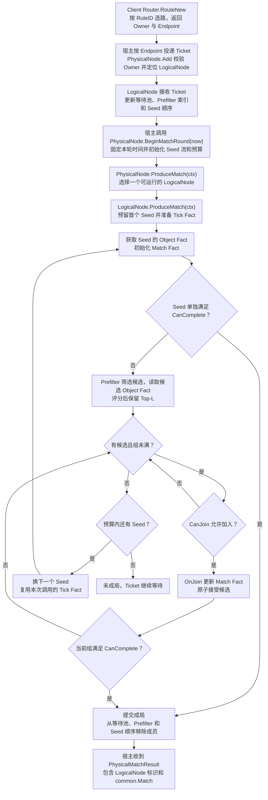

# 匹配运行时流程

## 从 Client 到 Match

新 Ticket 经 Client Router 选路后，由宿主发送到目标 `PhysicalNode`。宿主在入池后按轮次驱动匹配，
并消费核心返回的 `common.Match`。路由表由宿主根据物理节点快照、部署权重和 Endpoint 发布。
见 [Client Router 路由与选择器](client-router.md#从物理节点快照发布路由)。



- `ProduceMatch` 每次最多返回一组 Match，可在预算内尝试多个 Seed。已尝试但未成局的 Seed
  本轮仍可作为候选，下一轮才可再次作为 Seed。
- 物理节点没有可选逻辑节点时，默认选择器返回 `ErrNoLogicalNodeAvailable`。匹配调用的取消会立即返回，
  部分 Seed 错误允许继续尝试，具体见[错误、取消和轮次预算](#错误取消和轮次预算)。
- `common.Match` 携带成局的 Tickets，按节点的快照模式可附带 Fact。模拟器收到返回值后追加
  Match 历史。见 [Match 历史](../simulator/match-history.md)。

## 固定顺序

`PhysicalNode` 是其所拥有节点的单一 owner，外层必须串行调用 Load、Ticket 操作、
轮次操作和 ProduceMatch。每个 LogicalNode 从一份 `match-rule/v1` RuleJSON 编译出
自己的 Prefilter、Evaluation、评分、Seed 选择和 runtime；`BeginMatchRound(now)` 设定
本轮时间并启动 seed stream。宿主在本轮 `ProduceMatch` 消费结束前不得调用 `Add`；
新 Ticket 由宿主自行暂存，在下一轮开始前投递，核心不保证轮内添加的快照或延迟缓冲。

一次 `LogicalNode.ProduceMatch(ctx)` 中，每个 Seed 按以下顺序评估。Tick Fact 在首个 Seed 预留后准备，
供该次调用的所有 Seed 尝试复用。

```text
reserve seed
  -> 首个 Seed：FactProvider(ctx, {Now: round.now, Node: LogicalNodeSnapshot})
               FactFrame clone 并拥有 Tick Fact（generation）
  -> seed ObjectFactProvider 写入 per-Ticket slot
  -> MatchFactProvider.Initialize
  -> clone 并拥有完整 Match Fact
  -> CanComplete(Tick Fact, Match Fact)
       ├─ true  -> commit seed + Match Fact -> done
       └─ false -> Prefilter.Candidates(seed, seed Fact, Tick Fact)
                    -> candidate ObjectFactProvider 写入 per-Ticket slot
                    -> RuleJSON.scoring 的内置评分（建立 bounded Top-L）
                    -> 对排序后的 candidate 逐个：CanJoin
                         ├─ false -> 下一个 candidate
                          └─ true  -> MatchFactProvider.OnJoin
                                       -> clone 并拥有完整 Match Fact
                                      -> 原子接受 candidate + 新 Match Fact
                                      -> CanComplete(Tick Fact, 新 Match Fact)
                                           ├─ true  -> commit group + Match Fact
                                           └─ false -> 下一个 candidate
```

因此，`CanComplete` 的两次位置不是可配置的：第一次在 seed 初始化后，第二次在
每次成功的 `OnJoin` 原子接受后。没有成功加入时不会调用 `OnJoin`。

## 每个阶段的输入

- `FactProvider` 每次 `ProduceMatch` 最多调用一次，收到 `TickFactInput` 及其中当前
  `LogicalNodeSnapshot`（包括 active Ticket 的 `WaitingCount`）。其结果建立本次尝试
  共享的 Tick Fact 层；`FactFrame` 只 clone 并拥有该层，不在生产路径重复做完整 Fact
  Contract 校验。场景配置的 Python Provider 通过同一个调用端口传递该输入，Worker 的
  RPC 等待不会改变固定的 round `Now`。
- `ObjectFactProvider` 在每个 generation 内按 Ticket ID 缓存，每个 Ticket 最多计算一次；
  声明 Object Fact 的规则通过 schema-bound Writer 原地刷新 Add 时建立的 slot，空 layout
  的规则不创建 per-Ticket slot。Prefilter、Scorer 和后续 Evaluation 借用同一份 Object
  Fact。下一 generation 清除 presence、复用 list capacity，首次写入可扩容。
- `Initialize` 收到 `Now`、seed Ticket、seed Object Fact 和 Tick Fact，返回完整
  Match Fact。没有 Match scope Fact 的 Contract 不调用 Provider。
- `scoring` 是 RuleJSON 中绑定到该 LogicalNode 的内置评分配置。它每次读取 seed、
  candidate、`Now`、Tick/seed/candidate Fact 的借用只读视图；它不能读取已有 Match 成员或
  Match Fact。当前支持 `constant`、`created_at`、`int64_field`。评分错误或非有限值会使
  本次匹配尝试 fail closed。
- `CanJoin` 可以读 seed 属性、seed Fact、Tick Fact、candidate 属性、candidate Fact
  和加入前的完整 Match Fact，但不能读 Match 内已有成员数据。
- `OnJoin` 可以读相同的 seed/Tick/candidate 输入和加入前 Match Fact 的 clone，返回
  加入 candidate 后的完整 Match Fact。
- `CanComplete` 只可以读 Tick Fact 和当前完整 Match Fact；它不能读 seed、candidate
  或 Match 成员。

表达式的 source 与谓词 profile 见 [Evaluation](reference/evaluation.md)，Fact 快照
规则见 [Match Fact Provider](reference/match-fact-provider.md)。

## Prefilter 与评分

Prefilter 只负责通过索引产生候选 DocSet，不决定 Match 是否成立，也不扫描 Ticket
作为兜底。LogicalNode 从 DocSet 去掉 seed 后，按 `runtime.candidateScoringLimitPerSeed`
以 DocID 升序截断评分池，读取 candidate Object Fact 并执行 RuleJSON.scoring，保留有限的
Top-L（`runtime.candidateLimitPerSeed`）；只有这些排序后的候选才进入 `CanJoin`。因此 Prefilter
是必要的候选缩小步骤，Evaluation 是最终的加入/完成判定。

## 所有权与提交

LogicalNode 只在以下两个条件都满足后改变当前临时 group：

1. `OnJoin` 已返回；
2. 返回值已 clone 到 owner 内部。Provider 的完整 Match Fact Contract 由对应测试负责。

随后以同一次逻辑状态转换接受 candidate 和新快照。默认 MatchFactSnapshotMode.None 时，
commit 从池中移除 group 内所有 Ticket，返回 Match 只携带 Tickets；需要观察层输出时显式
选择 DeepCopy，才把 Match/Object Facts 复制到 `common.Match`，调用方可以安全持有返回值。
失败路径不会把旧快照替换成半成品，也不会通过重新遍历已有成员来补算表达式。

## 错误、取消和轮次预算

- context 在入口、阶段边界、候选迭代和 Provider 调用前后检查；取消或 deadline
  不会产生 Match。Python Worker 另有每次调用超时；超时后进程关闭，必须通过场景替换
  启动新 Worker。
- Tick / Match Fact Provider 错误和结构化评估错误会结束当前调用。普通 Object Fact 或
  Prefilter 错误允许在预算内尝试下一个 Seed。调用正常耗尽尝试且未成局时，汇总返回这些错误。Object Writer
  会拒绝未知名称、错误类型和超出 MaxValues 的写入，失败 slot 在下一 generation 重试。
  Provider panic 直接传播。
- `CanJoin`、`CanComplete` 或候选数据错误不会静默放行；评分错误不会用未完成的
  排名继续匹配。
- seed 在开始尝试前从本轮 cursor 保留；Provider 或评估失败也不会在同一轮重新选择
  该 seed。每次调用和整轮分别受配置的尝试上限约束。

相关实现：[ProduceMatch](../../pkg/matchsystem/logical_node.go)、[RuleJSON 编译](../../pkg/matchsystem/rule_config.go)、
[匹配评估](../../pkg/matchsystem/seed_evaluator.go)、[Ticket 生命周期](../../pkg/matchsystem/ticket_store.go)、
[PhysicalNode](../../pkg/matchsystem/physical_node.go)。
